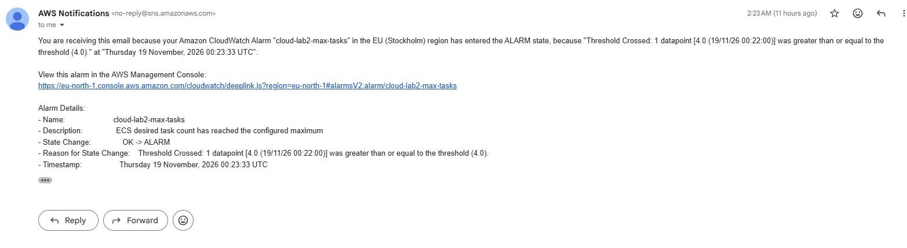
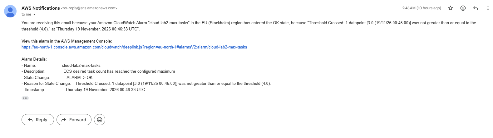

Моніторинг і email-сповіщення

Схема доставки повідомлень

Для доставки повідомлень використовується SNS topic cloud-lab2-alerts з email-підпискою. CloudWatch alarms передають повідомлення до SNS під час переходів у стани ALARM та OK, якщо для відповідного стану налаштовано дію сповіщення.

Alarm максимальної кількості ECS tasks

Основне правило сповіщення про досягнення межі масштабування має назву cloud-lab2-max-tasks. Воно відстежує метрику DesiredTaskCount у просторі імен ECS/ContainerInsights. Умова ALARM спрацьовує, коли значення метрики дорівнює або перевищує 4, тобто коли сервіс досягає налаштованої максимальної кількості tasks. Період оцінювання становить 60 секунд. SNS topic підключений до alarm_actions та ok_actions.

Коли DesiredTaskCount досягає 4, CloudWatch переводить alarm у стан ALARM і надсилає повідомлення. Коли значення зменшується нижче 4, alarm повертається до стану OK і надсилає відповідне повідомлення. Отже, стан OK для цього правила означає, що сервіс більше не перебуває на максимальній межі 4 tasks. Він не означає автоматично, що кількість tasks уже повернулася до мінімального значення 1.

Фактичні переходи під час хмарного тесту

Усі наведені нижче часові позначки відповідають місцевому часу Києва, UTC+02:00, 19 листопада 2026 року.

DesiredTaskCount досяг 4 о 02:22:14. У повідомленні SNS про перехід у стан ALARM час події вказано як 00:23:33 UTC, що відповідає 02:23:33 за Києвом. Отже, повідомлення має часову позначку приблизно через 1 хвилину 19 секунд після зафіксованого досягнення DesiredTaskCount значення 4. Цей інтервал включає оцінювання CloudWatch alarm та доставку повідомлення SNS.

Навантажувальний тест завершився о 02:27:35. DesiredTaskCount зменшився до 3 о 02:44:38. У повідомленні SNS про повернення alarm у стан OK час події вказано як 00:46:33 UTC, що відповідає 02:46:33 за Києвом. Отже, повідомлення OK надійшло приблизно через 18 хвилин 58 секунд після завершення тесту та через 1 хвилину 55 секунд після зафіксованого зменшення DesiredTaskCount до 3.

Після повідомлення OK масштабування вниз продовжилося. DesiredTaskCount зменшився до 2 о 02:48:38 та до 1 о 02:52:38. Таким чином, повернення alarm у стан OK і повернення ECS до однієї task — це різні події. Перша відбулася, коли кількість tasks стала меншою за поріг 4; друга відбулася пізніше, коли сервіс досяг мінімальної конфігурації. Остаточний стан сервісу становив Desired 1, Running 1, Pending 0.

Часові позначки в тілі листів AWS наведено в UTC. Для порівняння з часовою шкалою навантажувального тесту до них додано дві години, щоб отримати місцевий час Києва. Різниця між моментом зміни метрики, переходом alarm у новий стан і отриманням листа пояснюється періодом оцінювання CloudWatch та доставкою SNS.

Додаткові сигнали моніторингу

Окрім досягнення максимальної кількості tasks, налаштовано моніторинг CPU utilization та p95 latency. Alarm cloud-lab2-high-p95-latency використовує метрику AWS/ApplicationELB TargetResponseTime зі статистикою p95, поріг 0,5 секунди, період 60 секунд і два періоди оцінювання. Це дає змогу відстежувати затримку на рівні балансувальника окремо від сигналу про досягнення максимальної кількості ECS tasks.

Час появи метрики, спрацювання CloudWatch Alarm і отримання листа SNS не збігався. Лист про нормалізацію стану надійшов приблизно через 20 хвилин після завершення тесту. Це свідчить про затримку сповіщення. Після тесту кількість екземплярів сервісу не повернулася до початкового значення
