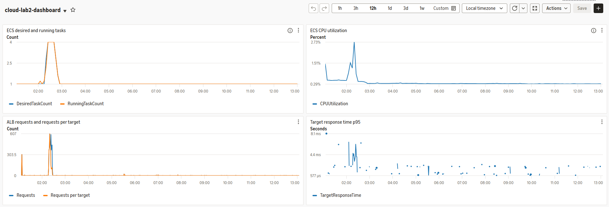
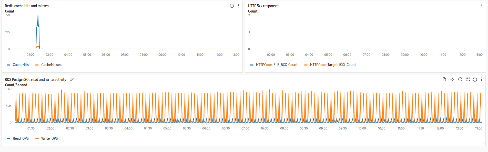

Автоматичне масштабування ECS

Конфігурація політики

Для ECS service cloud-lab2-service налаштовано горизонтальне масштабування типу Target Tracking за метрикою ALBRequestCountPerTarget. Мінімальна кількість tasks становить 1, максимальна — 4. Цільове значення метрики становить 80 запитів на один target за хвилину.

Обґрунтування цільового значення

Під час хмарного навантажувального тесту середня інтенсивність становила 7,03 запиту за секунду, або приблизно 422 запити за хвилину для сервісу загалом. Якщо умовно розподілити цей потік між чотирма tasks рівномірно, середнє навантаження становитиме приблизно 105,5 запиту на target за хвилину.

Цільове значення 80 запитів приблизно на 24% нижче від цієї розрахункової оцінки. Такий поріг створює запас відносно середнього навантаження, зафіксованого під час тесту, і дає змогу ініціювати масштабування до досягнення цього рівня. Розрахунок є наближеним: фактичний розподіл запитів між targets може бути нерівномірним, а середня інтенсивність тесту не описує короткочасні піки. Тому значення 80 є початковою ціллю для використаного профілю навантаження, а не універсально оптимальним порогом.

Періоди стабілізації

Scale-out cooldown становить 60 секунд. Коротший період після збільшення кількості tasks дає змогу політиці повторно оцінити навантаження після запуску нових контейнерів, проходження health checks та реєстрації targets у балансувальнику. Він зменшує ймовірність надто довго чекати на наступне збільшення потужності, якщо навантаження продовжує зростати.

Scale-in cooldown становить 180 секунд. Зменшення кількості tasks відбувається обережніше, ніж збільшення, оскільки короткочасне падіння навантаження не обов'язково означає, що додаткові ресурси більше не потрібні. Довший період стабілізації знижує ризик частих коливань кількості tasks, передчасного вилучення ресурсів і повторного масштабування вгору.

Часова шкала хмарного тесту

Усі наведені часові позначки відповідають місцевому часу Києва, UTC+02:00, 19 листопада 2026 року.

Навантажувальний тест розпочався о 02:17:36. Steady-фаза почалася о 02:20:36. DesiredTaskCount досяг 4 о 02:22:14, тобто через 1 хвилину 38 секунд після початку steady-фази. Цей інтервал включає накопичення метрик, оцінювання scaling policy, запуск ECS tasks та проходження перевірок готовності.

Тест завершився о 02:27:35. Масштабування вниз відбувалося поступово: DesiredTaskCount зменшився до 3 о 02:44:38, до 2 о 02:48:38 та до 1 о 02:52:38. Повернення до мінімальної конфігурації зайняло 25 хвилин 03 секунди після завершення тесту.

Після завершення масштабування стан сервісу становив Desired 1, Running 1, Pending 0. Отже, повернення до однієї task відбулося не одразу після завершення навантаження, а після поступового зменшення кількості tasks.

Панель CloudWatch

Панель cloud-lab2-dashboard містить вісім віджетів, розподілених між двома знімками. Основний знімок показує DesiredTaskCount разом із RunningTaskCount, CPUUtilization, кількість ALB requests, requests per target та TargetResponseTime зі статистикою p95. Часова шкала дає змогу зіставити період навантаження з моментом збільшення та подальшого зменшення кількості ECS tasks.

Додатковий знімок містить метрики Redis CacheHits і CacheMisses, HTTPCode_ELB_5XX_Count, HTTPCode_Target_5XX_Count та активність читання й запису RDS PostgreSQL.

Клієнтська затримка та метрика ALB

Під час хмарного тесту клієнтський p95 становив 10074,05 мс. На графіку AWS/ApplicationELB TargetResponseTime p95 відображалися значно менші значення. Ці вимірювання охоплюють різні частини повного часу запиту. Клієнтський таймер охоплює шлях від генератора навантаження до отримання відповіді, тоді як TargetResponseTime характеризує час на стороні цільового ресурсу за визначенням метрики ALB. Тому ці показники не є взаємозамінними.

Під час хмарного тестування клієнтський p95 досяг приблизно 20 секунд. Це свідчить про значне погіршення часу відповіді сервісу під навантаженням. Показник ALB був нижчим, тому для точного визначення причини затримки потрібен додатковий аналіз
